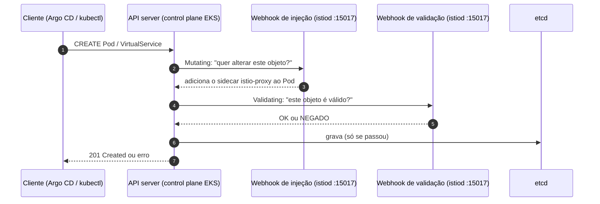
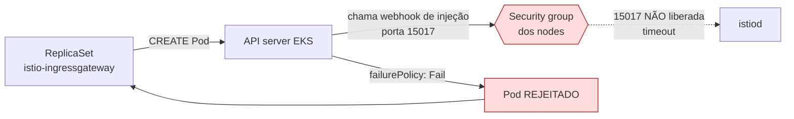
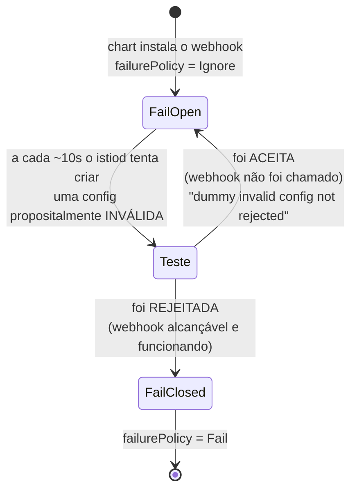
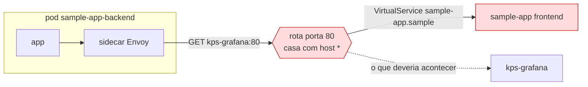

# Postmortem: configuração inválida do Istio entrou em prod enquanto a validação estava desligada

- **Data:** 2026-11-23
- **Severidade:** SEV-3 (sem impacto ao cliente detectado; risco latente alto)
- **Ambientes:** `eks-prod` (afetado), `eks-stg` (detectou)
- **Formato:** *blameless*: o foco é o sistema que permitiu o erro, não quem o cometeu.

## Resumo

Três falhas encadeadas, todas com a mesma raiz (**a porta 15017 bloqueada no security group dos nodes do EKS**):

1. **Pods do ingress gateway não nasciam** (o webhook de *injeção* de sidecar estava inalcançável).
2. **A validação do Istio ficou desligada (fail-open) por cerca de 2h40**, e um `VirtualService` inválido entrou em prod.
3. **Esse `VirtualService` sequestrou rotas de outros serviços** dentro do mesh (o Grafana e o ingress gateway, na porta 80).

O problema só apareceu quando o `eks-stg`, criado depois e já com a correção, **recusou o mesmo manifesto**.

---

## Como o Kubernetes valida e altera objetos (o pano de fundo)



- Os dois webhooks são **o mesmo `istiod`**, na porta **15017** do pod.
- O **API server do EKS roda na VPC da AWS**, fora dos nodes. Para chamar o webhook, ele atravessa o **security group dos nodes**.
- `failurePolicy` decide o que fazer **se o webhook não responder**: `Fail` = recusa (fail-closed), `Ignore` = deixa passar sem validar (fail-open).

---

## Falha 1: pods que nunca nascem



**Sintomas:**
- Deployment com `READY 0/2` e ReplicaSet com `DESIRED 2, CURRENT 0`.
- **Nenhum pod**, e por isso nenhum log nem `describe pod`: o pod nem chega a existir.
- O erro só aparece nos **eventos do ReplicaSet**:
  ```
  Error creating: Internal error occurred: failed calling webhook
  "namespace.sidecar-injector.istio.io": ... Post "https://istiod.istio-system.svc:443/inject": context deadline exceeded
  ```

**Por que não aconteceu no kind:** no kind não existe security group; o API server e os pods estão na mesma rede do Docker.

**Correção:** `webhook_ports = [15017]` no módulo `aws-eks` (regra de SG: control plane → nodes). O módulo upstream só libera 443, 4443, 6443, 8443, 9443 e 10250.

---

## Falha 2: a validação ficou desligada (fail-open) por 2h40

O Istio **começa fail-open de propósito**. Se nascesse com `Fail` e o `istiod` tivesse qualquer problema, nenhum recurso do Istio poderia ser criado, nem os que ele mesmo precisa para se consertar. Então ele só passa para `Fail` **depois de provar** que a validação funciona:



**Linha do tempo real (logs do `istiod` em prod, UTC):**

```mermaid
timeline
    title eks-prod, 2026-11-23
    11:0x : Istio instalado : webhook de validação em Ignore (fail-open)
    11:06:04 : Argo CD cria o VirtualService sample-app com host "*" + gateway mesh : API server não alcança o webhook (15017) : Ignore = aceita SEM validar
    11:23 → 13:48 : istiod tenta fail-closed 294 vezes : "Not ready to switch validation to fail-closed"
    13:49:30 : apply da regra 15017 (Atlantis) : istiod prova a validação e muda para Fail
    depois : o VirtualService inválido continua lá (generation 1) : webhooks só rodam em CREATE/UPDATE
```

**O ponto central:** admission webhooks **não revalidam** o que já existe. O objeto que entrou durante a janela fail-open ficou em prod, intocado.

**Por que o `failurePolicy` "Fail" de hoje não prova nada:** ele foi alterado **depois** que o objeto entrou. E é o `istiod` quem muda esse campo em tempo de execução (por isso o Argo CD tem `ignoreDifferences` nele; sem isso, cada sync voltaria para `Ignore`).

---

## Falha 3: o `VirtualService` com `*` sequestrou rotas de outros serviços

O manifesto:

```yaml
kind: VirtualService
spec:
  hosts: ["*", sample-app.sample.svc.cluster.local]
  gateways: [istio-ingress/public-gateway, mesh]   # "mesh" = vale para TODOS os sidecars
```

No gateway de entrada, `*` significa "qualquer host que chegar de fora", o que é razoável. No gateway **`mesh`**, `*` significa "**qualquer destino HTTP chamado de dentro do mesh**":



**Evidência** (`istioctl proxy-config routes <pod-do-backend> -n sample`):

```
DOMAINS                                        VIRTUAL SERVICE
istio-ingressgateway.istio-ingress...          sample-app.sample     <- sequestrado
kps-grafana.observability...                   sample-app.sample     <- sequestrado
sample-app-backend.sample...                   sample-app-backend.sample
```

**Impacto real:** nenhum detectado, porque nada em `sample` chama o Grafana ou o gateway pela porta 80. **Impacto potencial:** qualquer chamada HTTP na porta 80 de dentro do mesh para outro serviço iria parar no sample-app, **em silêncio**, sem erro de configuração visível no serviço afetado.

**Bomba-relógio:** a próxima alteração nesse VS (peso de canary, timeout) seria um `UPDATE`, agora validado com `Fail`, e seria **recusada**. O deploy de prod quebraria no meio de uma mudança.

---

## Como foi detectado

O `eks-stg` foi criado **depois** da correção da porta 15017. A validação já nasceu funcional e **recusou** o mesmo manifesto:

```
admission webhook "validation.istio.io" denied the request:
wildcard host * is not allowed for virtual services bound to the mesh gateway
```

Detecção por sorte (a ordem em que os clusters foram criados), não por controle. Os itens de ação abaixo mudam isso.

---

## Causas (5 porquês)

1. **Por que o VS inválido entrou em prod?** A validação estava fail-open.
2. **Por que fail-open?** O `istiod` não conseguia provar que o API server o alcançava.
3. **Por que não alcançava?** A porta 15017 não estava liberada no SG dos nodes.
4. **Por que ninguém percebeu por 2h40?** Não havia **alerta** de "validação fail-open" e **nenhuma validação offline** no CI. O primeiro sintoma (pods do gateway sem nascer) foi tratado como um problema isolado, sem perguntar "o que mais esse webhook deixou de fazer?".
5. **Por que o manifesto estava errado e ninguém viu antes?** O chart juntava borda e mesh num VS só. No `kind-dev` (com validação funcionando) o host é `sample.localtest.me`, que é válido no mesh; o valor `*` só existia nos values de **prod**, e prod era o único lugar onde ele foi aplicado, justamente com a validação desligada. Nenhum CI validava os manifestos com as regras do Istio.

## Itens de ação

| # | Ação | Tipo | Status |
|---|---|---|---|
| 1 | Regra de SG 15017 no módulo `aws-eks` (`webhook_ports`) | Correção | ✅ v0.1.1/v0.1.2 |
| 2 | Separar o VS de borda (host público, gateway de entrada) do VS de mesh (host interno) | Correção | ✅ `sample-app-deploy` |
| 3 | `istioctl validate` no CI do `sample-app-deploy` (as mesmas regras do webhook, sem cluster) | **Prevenção (shift left)** | ✅ |
| 4 | `istioctl analyze -A` periódico (CronJob ou CI agendado) contra os clusters | Detecção | a fazer |
| 5 | Alerta: webhook de validação do Istio em `Ignore` por mais de 15 min após a instalação | Detecção | a fazer |
| 6 | Runbook de debug do Istio ([runbooks/istio.md](../runbooks/istio.md)) | Resposta | ✅ |
| 7 | Hostname real em vez de `*` (passo do DNS: `app.prod.<domínio>`) | Correção definitiva | a fazer |

## Lições

- **Erro que some quando você repete não é sorte.** O primeiro apply do EKS falhou e "passou na segunda". O gateway não subia e foi "resolvido" apagando o ReplicaSet. Cada sintoma foi tratado isoladamente.
- **Fail-open é uma escolha de disponibilidade com custo de segurança.** Ela precisa de alerta enquanto durar.
- **Staging criado do zero é um teste.** Clusters recriáveis (IaC + GitOps) revelam o que um cluster antigo esconde.
