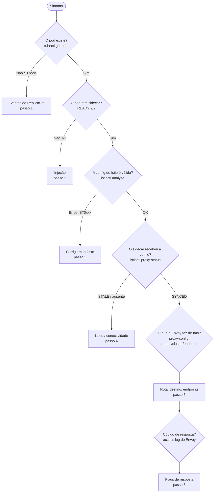

# Runbook: debug do Istio

Ordem: **do sintoma para dentro**. Cada passo responde uma pergunta. Não pule para o Envoy antes de saber se o pod existe.



> zsh: coloque entre aspas simples qualquer argumento com `[ ]`, `*`, `?` ou `|`.

---

## Passo 1: o pod não existe

```bash
kubectl -n <ns> get deploy,rs,pods
kubectl -n <ns> describe rs <replicaset> | tail -20
kubectl -n <ns> get events --sort-by=.lastTimestamp | tail -20
```

| Evento | Causa provável | O que fazer |
|---|---|---|
| `failed calling webhook "namespace.sidecar-injector.istio.io" ... context deadline exceeded` | O API server não alcança o `istiod` na **15017** (EKS: security group dos nodes; GKE privado: regra de firewall do master) | Liberar 15017 do control plane para os nodes. **Depois:** verificar a validação (passo 3b), porque ela também estava fora. |
| `... no endpoints available for service "istiod"` | O `istiod` está fora do ar | `kubectl -n istio-system get pods`, logs do istiod |
| `exceeded quota` / `forbidden` | ResourceQuota, LimitRange ou PodSecurity | `kubectl describe quota -n <ns>` |

O ReplicaSet usa **backoff exponencial** entre as tentativas. Depois de corrigir a causa, apagar o ReplicaSet (o Deployment recria na hora) ou fazer `kubectl rollout restart`.

## Passo 2: o pod não tem sidecar (`1/1` em vez de `2/2`)

```bash
kubectl get ns <ns> --show-labels                      # istio-injection=enabled? istio.io/rev=?
kubectl -n <ns> get pod <pod> -o jsonpath='{.metadata.annotations.sidecar\.istio\.io/status}'
istioctl x check-inject -n <ns> <pod>                  # explica se e por que injeta
```

| Causa | Como reconhecer |
|---|---|
| Namespace sem label | `istio-injection` ausente |
| **O pod nasceu antes do `istiod`** (corrida de ordem) | O pod é mais velho que o webhook: `kubectl get mutatingwebhookconfiguration -o wide` (veja o AGE). **Solução:** reiniciar o pod. **Prevenção:** os workloads só ganham `workloads=enabled` depois que os addons ficam saudáveis. |
| Anotação `sidecar.istio.io/inject: "false"` | Está no template do pod |

## Passo 3: a configuração do Istio está válida?

```bash
istioctl analyze -n <ns>            # namespace
istioctl analyze -A                 # cluster inteiro
istioctl validate -f manifest.yaml  # offline, antes de aplicar (CI)
```

Códigos que mais aparecem:

| Código | Significado | Efeito |
|---|---|---|
| **IST0106** | Erro de schema/validação (ex.: `wildcard host * ... mesh gateway`) | O objeto **não deveria existir**. Se existe, entrou com a validação desligada (3b). |
| **IST0101** | Referência a algo que não existe (gateway, host, secret) | Rota ignorada |
| **IST0173** | Subset do DestinationRule não seleciona nenhum pod | Se receber peso: **503 `UH`** |
| **IST0128/0129** | DestinationRule sem TLS ou SNI coerente | Falha de TLS |
| **IST0145** | Conflito de host entre gateways | Rota imprevisível |

### 3b: a validação está ligada?

```bash
kubectl get validatingwebhookconfiguration -o 'custom-columns=NAME:.metadata.name,POLICY:.webhooks[*].failurePolicy'
kubectl -n istio-system logs deploy/istiod | grep -i 'fail-closed'
```

- `Ignore` muito depois da instalação, ou logs `Not ready to switch validation to fail-closed`, significa que a validação está **desligada**. Tudo o que foi aplicado nesse período precisa passar pelo `istioctl analyze -A`.

## Passo 4: o sidecar recebeu a configuração?

```bash
istioctl proxy-status                        # todos os proxies
istioctl proxy-status <pod>.<ns>             # diff entre o que o istiod mandou e o que o Envoy tem
```

- `SYNCED` em CDS/LDS/EDS/RDS: o Envoy tem a última config.
- `STALE` ou proxy ausente: problema entre o sidecar e o `istiod` (rede, certificado, `istiod` sobrecarregado). Ver `kubectl -n istio-system logs deploy/istiod` e o `istio-proxy` do pod.

## Passo 5: o que o Envoy faz de fato

**O YAML diz o que você pediu; o `proxy-config` diz o que você conseguiu.**

```bash
istioctl x describe pod <pod> -n <ns>                              # resumo: VS, DR, mTLS que se aplicam
istioctl proxy-config listener <pod> -n <ns>                       # portas interceptadas
istioctl proxy-config routes   <pod> -n <ns>                       # para onde cada host/porta vai, e QUAL VirtualService
istioctl proxy-config cluster  <pod> -n <ns>                       # destinos conhecidos (com subsets)
istioctl proxy-config endpoint <pod> -n <ns> \
  --cluster 'outbound|8080||sample-app-backend.sample.svc.cluster.local'   # IPs e HEALTHY/UNHEALTHY
```

| Você vê | Significa |
|---|---|
| A coluna `VIRTUAL SERVICE` de um host aponta para um VS **de outro serviço** | VS com host largo demais (`*`) sequestrando rotas (postmortem 2026-11-23) |
| Endpoint `UNHEALTHY` | Readiness falhando ou **outlier detection** ejetou o pod (5xx em sequência) |
| Nenhum endpoint no cluster de um subset | Subset sem pods (IST0173): 503 `UH` |
| Host sem rota | Não existe Service ou ServiceEntry para ele; com `outboundTrafficPolicy: REGISTRY_ONLY` vira 502 `BlackHoleCluster` |

## Passo 6: o código de resposta e as flags do Envoy

```bash
kubectl -n <ns> logs <pod> -c istio-proxy --tail=50
```

Cada linha do access log traz o **response flag**, que é a pista mais rápida que existe:

| Flag | Significa | Causa típica |
|---|---|---|
| `UH` | No healthy upstream | Todos os endpoints ejetados ou nenhum pod no subset |
| `UF` | Upstream connection failure | O pod destino recusou ou não escutava |
| `URX` | Retries esgotados | O destino falhou em todas as tentativas |
| `UT` | Upstream timeout | Timeout do VirtualService estourou (504) |
| `UO` | Overflow | Circuit breaker (connectionPool) cheio |
| `NR` | No route | Nenhuma rota casou (host/path/header) |
| `RBAC: access denied` (403) | AuthorizationPolicy negou | Principal/porta/path não liberados: `istioctl x describe pod` mostra as políticas |
| `UC` | Upstream connection termination | O app fechou a conexão (crash, keep-alive) |

### mTLS e autorização

```bash
istioctl x describe pod <pod> -n <ns> | grep -iA3 'mtls\|authorization'
kubectl get peerauthentication,authorizationpolicy -A
```

- 503 com `upstream connect error ... TLS error`: um lado exige mTLS (STRICT) e o outro não tem sidecar. Exceção por porta: `PeerAuthentication` com `portLevelMtls` (ex.: porta de métricas para o Prometheus sem sidecar).
- 403 `RBAC: access denied`: uma `AuthorizationPolicy` ALLOW existe no destino e a origem não está nela. **Lembrete:** ALLOW sem regras = nega tudo.
